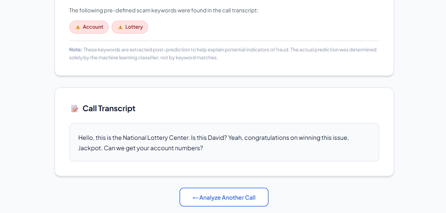
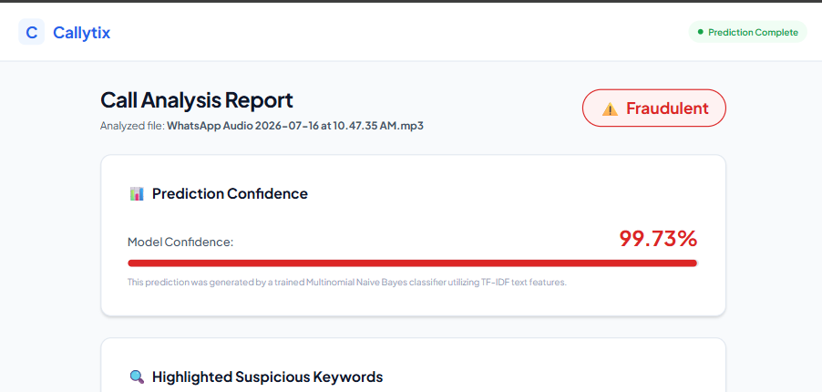

# Callytix: AI-Based Fraud Phone Call Detection System

Callytix is an AI-based project designed to detect fraudulent phone calls (such as bank impersonations, lottery scams, and OTP harvesting) from audio recordings. The system transcribes the call audio using OpenAI Whisper and classifies the text as **Fraudulent** or **Legitimate** using a Multinomial Naive Bayes classifier trained on a composite scam transcript dataset.

---

## 🚀 Features

- **Speech-to-Text Transcription**: Automatically transcribes uploaded audio files (`.wav`, `.mp3`, `.m4a`, etc.) using the OpenAI Whisper `small` model.
- **Machine Learning Classification**: Predicts whether the transcribed text is Fraudulent or Legitimate using TF-IDF vectorization and a Multinomial Naive Bayes model.
- **Confidence Scoring**: Computes and displays the model's confidence percentage for the prediction.
- **Explainable Highlights**: Scans the transcript for key suspicious phrases (like `OTP`, `KYC`, `Bank`, `Customs`) and highlights them on the dashboard to assist in explanation.
- **On-Demand Training**: Allows training and evaluating the model directly from the web interface, displaying validation metrics (Accuracy, Precision, Recall, F1 Score) and a Confusion Matrix.
- **College-Focused Architecture**: Structured, clean, and beginner-friendly codebase containing no databases, complex microservices, or external API costs.

---

## 📊 Dataset

The project uses the **Composite Scam Transcript Dataset** hosted on Kaggle (`ibrahimbagwan12/composite-scam-transcript-dataset`).
- **Total Samples**: ~36,750 training examples and ~9,180 testing examples.
- **Columns**:
  - `text`: Text transcript of the conversation.
  - `label`: Binary classification (1 = Fraudulent/Scam, 0 = Legitimate/Normal).

---

## ⚙️ Project Architecture

```
                      +-------------------+
                      |   Audio Upload    |
                      +---------+---------+
                                |
                                v
                      +-------------------+
                      |   OpenAI Whisper  |
                      |   (small model)   |
                      +---------+---------+
                                | (Transcript Text)
                                v
                      +-------------------+
                      |   Text Cleaning   |
                      |  (preprocess.py)  |
                      +---------+---------+
                                | (Clean Tokens)
                                v
                      +-------------------+
                      | TF-IDF Vectorizer |
                      | (vectorizer.pkl)  |
                      +---------+---------+
                                | (Feature Vector)
                                v
                      +-------------------+
                      |  Multinomial NB   |
                      |    (model.pkl)    |
                      +---------+---------+
                                |
                                v
                      +-------------------+
                      | Prediction Output |
                      |    (Confidence)   |
                      +-------------------+
```

---

## 📂 Folder Structure

```text
Callytix/
│
├── app.py                  # FastAPI Backend & Web Server
├── train.py                # Machine Learning Training Pipeline
├── predict.py              # ML Prediction & Suspicious Keyword Extraction
├── whisper_service.py      # Speech-to-Text via OpenAI Whisper
├── preprocess.py           # Text Preprocessing & Stopword Removal
├── requirements.txt        # Python Packages List
├── README.md               # Project Documentation
│
├── models/
│   ├── model.pkl           # Saved Naive Bayes Model weights
│   └── vectorizer.pkl      # Saved TF-IDF Vectorizer weights
│
├── uploads/                # Temporary Audio Upload storage (auto-cleaned)
│
├── templates/
│   ├── index.html          # Web Frontend Dashboard
│   └── result.html         # Analysis Results Page
│
└── static/
    ├── style.css           # Modern Custom CSS stylesheet
    └── script.js           # AJAX Training and Drag-and-Drop Handler
```

---

## 🛠️ Installation & Setup

### 1. Prerequisites
Ensure you have **Python 3.9+** and **pip** installed.
Additionally, OpenAI Whisper requires **FFmpeg** to process and decode audio files.

#### Windows FFmpeg Setup (Automated via winget)
The project automatically checks for a Windows package manager (`winget`) installation of FFmpeg at runtime. To install it:
1. Open PowerShell or Command Prompt.
2. Run the following command:
   ```bash
   winget install Gyan.FFmpeg.Essentials --accept-source-agreements --accept-package-agreements
   ```
3. The backend script `whisper_service.py` is configured to dynamically find this WinGet installation and append it to your environment `PATH` at runtime, so no system restart or manual variable setup is needed!

#### macOS & Linux FFmpeg Setup
- **macOS**: `brew install ffmpeg`
- **Linux**: `sudo apt install ffmpeg`

### 2. Setup Workspace & Install Dependencies
1. Clone or extract the project files to a local directory.
2. Install the necessary packages. To prevent compatibility issues between precompiled PyTorch binaries and NumPy 2.x, the project pins `numpy<2.0.0`:
   ```bash
   pip install -r requirements.txt
   ```

---

## 🏋️ Training the Model

Before making predictions, you must train the machine learning model. You can do this in two ways:

### Option A: Command Line (Recommended first run)
Run the training script standalone:
```bash
python train.py
```
This will:
1. Download the Kaggle dataset automatically via `kagglehub`.
2. Preprocess the transcripts.
3. Train the model.
4. Print the final metrics (Accuracy, Precision, Recall, F1 Score) and Confusion Matrix.
5. Save the trained outputs inside the `models/` directory.

### Option B: Web Dashboard
Start the web app, and click the **"Train Model Now"** button on the page.

---

## 🖥️ Running the Application

To start the FastAPI web server:
```bash
python app.py
```
Or use Uvicorn directly:
```bash
uvicorn app:app --reload
```

Once started, open your web browser and navigate to:
```
http://127.0.0.1:8000/
```

1. Select or drag a call audio recording (wav/mp3) into the uploader.
2. Click **"Analyze & Predict Call"**.
3. View the transcript, the classification output (Fraudulent vs. Legitimate), the confidence score, and highlighted suspicious words.

### Render Deployment

The Whisper `small` model runs on CPU when no GPU is available and is loaded on the first prediction request. Use a Render web service instance with enough memory for PyTorch and Whisper inference. The first request may also take longer while Whisper downloads its model weights. If a prediction request returns `502 Bad Gateway`, check the Render service logs for a worker restart or memory-related failure.

---

## 🔧 Troubleshooting

If you encounter errors during setup or prediction, check these solutions:

### 1. `Numpy is not available` / `Failed to initialize NumPy: _ARRAY_API not found`
- **Cause**: PyTorch was compiled with NumPy 1.x, but your environment has NumPy 2.x installed.
- **Solution**: Downgrade NumPy to 1.x:
  ```bash
  pip install "numpy<2.0.0"
  ```
  The `requirements.txt` file has been pinned to `numpy<2.0.0` to avoid this.

### 2. `Speech-to-text transcription failed: [WinError 2] The system cannot find the file specified`
- **Cause**: OpenAI Whisper cannot locate the `ffmpeg` executable in your system execution `PATH`.
- **Solution**: Install FFmpeg using `winget` as specified in the installation steps. The app will automatically resolve and inject the path at runtime. If you installed FFmpeg manually elsewhere, ensure its `bin` folder is added to your User/System environment variables.

---

## 📸 Screenshots

### System UI (Main Dashboard)
Here is the homepage interface for uploading call recordings and managing the machine learning model:



### Demo Testing (Analysis Report)
Here is the result screen showing the transcribed text, model classification prediction, confidence score, and highlighted keywords:




---

## Information

1. **Why use Multinomial Naive Bayes instead of Deep Learning (like BERT)?**
   - Naive Bayes is extremely fast, highly efficient, and uses very little memory. It works exceptionally well for text classification when combined with TF-IDF, making it easy to run on standard computers without needing an expensive GPU. It serves as an excellent baseline and keeps the project code simple and easy to explain.

2. **How does TF-IDF work?**
   - TF-IDF stands for *Term Frequency-Inverse Document Frequency*. It converts text into numerical vectors. 
     - **Term Frequency (TF)** measures how often a word appears in a specific document.
     - **Inverse Document Frequency (IDF)** measures how unique/rare the word is across all documents in the dataset. Words like "the" get low scores, while words like "OTP" or "verification" get higher scores because they are rare and carry more information.

3. **What is the Naive Bayes assumption?**
   - It assumes that the presence of a particular feature (word) in a class is completely independent of the presence of any other feature. Although this assumption is "naive" and rarely holds true in natural language, Naive Bayes classifiers still perform remarkably well in practice.

4. **Why use Whisper small model?**
   - The `small` model offers the best balance between transcription accuracy and computational speed on consumer hardware. It consumes about 2GB of VRAM and runs efficiently on CPU as a fallback.

---

## 🔮 Future Scope

- **Real-Time Call Interception**: Developing a mobile plugin or VoIP gateway to analyze incoming calls in real-time.
- **Multi-Lingual Support**: Extending training datasets to include regional/vernacular languages (e.g., Hindi, Spanish) where fraud is highly active.
- **Voice Biometrics**: Analyzing caller pitch, stress levels, and background noise anomalies to detect synthesized or deepfake voice profiles.
